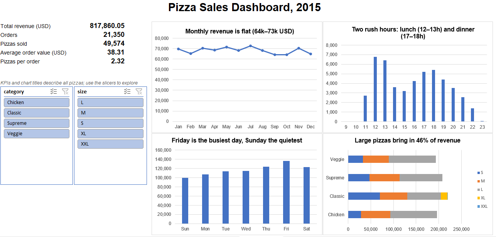
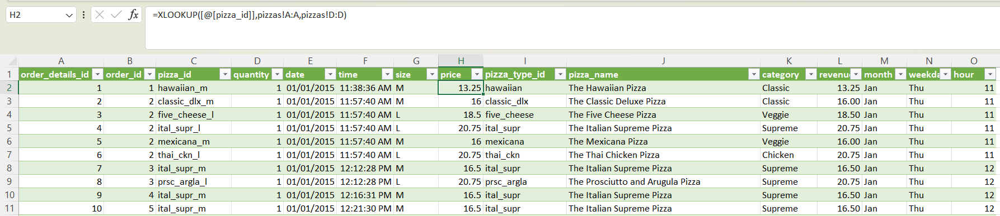

# Pizza Sales Analysis in Excel

An Excel project analysing one year of sales for a pizza restaurant: when it is busiest, which pizzas sell best, and what the owner could change.

**Tools:** Excel (Power Query, XLOOKUP, pivot tables, pivot charts, slicers)

**Data:** [Pizza Place Sales](https://mavenanalytics.io/data-playground/pizza-place-sales) from Maven Analytics (public domain). 21,350 orders and 48,620 order lines from 2015, in 4 related tables.

## Questions

1. Are sales growing, shrinking or flat across the year?
2. When are the busiest days and hours?
3. Which pizzas, categories and sizes sell best and worst?

## What I did

1. **Imported** the 4 CSV files with Power Query (`orders`, `order_details`, `pizzas`, `pizza_types`), and set the file encoding so a special character in one pizza's ingredients displays correctly.
2. **Checked the data:** no duplicates or blanks, and every ID links to its table. I found 7 days with no orders (probably closed days, including every Monday in October) and 5 pizza options that were never sold.
3. **Built one sales table** by adding columns to `order_details` with **XLOOKUP**: date, time, size, price, pizza name and category, plus revenue (quantity × price), month, weekday and hour.
4. **Checked the totals:** revenue 817,860.05 USD, 49,574 pizzas, 21,350 orders.
5. **Analysed** with 5 pivot tables (month, weekday, hour, pizza, category × size).
6. **Built a dashboard** with 5 KPIs, 4 pivot charts and 2 slicers (category, size) that filter every chart.

## Key numbers

| Total revenue | Orders | Pizzas sold | Average order value | Pizzas per order |
| --- | --- | --- | --- | --- |
| 817,860.05 USD | 21,350 | 49,574 | 38.31 USD | 2.32 |

## Findings

1. **Sales are flat:** monthly revenue stays between 64k and 73k USD. October is lowest, partly because the shop had no orders on its 4 Mondays.
2. **Two rush hours:** 12–13h and 17–18h sell 48% of all pizzas in just 4 hours. Almost nothing sells before 11:00 or after 22:00.
3. **Friday is the busiest day** (16.6% of revenue) and Sunday the quietest (12.1%).
4. **The top 3 pizzas are all chicken pizzas**, and Large pizzas bring in 46% of revenue.
5. **XL and XXL are only offered for The Greek Pizza**; XXL sold just 28 times all year.

## Recommendations

1. Plan staff and oven capacity around 12–13h and 17–18h, especially on Fridays and Saturdays.
2. Use promotions to fill quiet times: Sundays and the 14–16h gap.
3. Review the menu: consider dropping XXL, and feature the chicken pizzas. Check The Brie Carre before cutting it: it has the lowest revenue, but it is only offered in Small.

## Limitations

- One restaurant, one year (2015).
- No cost data, so profit can't be measured.
- No customer data.
- Closed days are inferred from days with no orders.

## Files

| File | What it is |
| --- | --- |
| `pizza_sales_analysis.xlsx` | The workbook: Dashboard, Insights, Analysis (pivot tables), and the 4 data tables |
| `data/raw/` | The original CSV files and data dictionary |
| `images/` | Screenshots used in this README |
